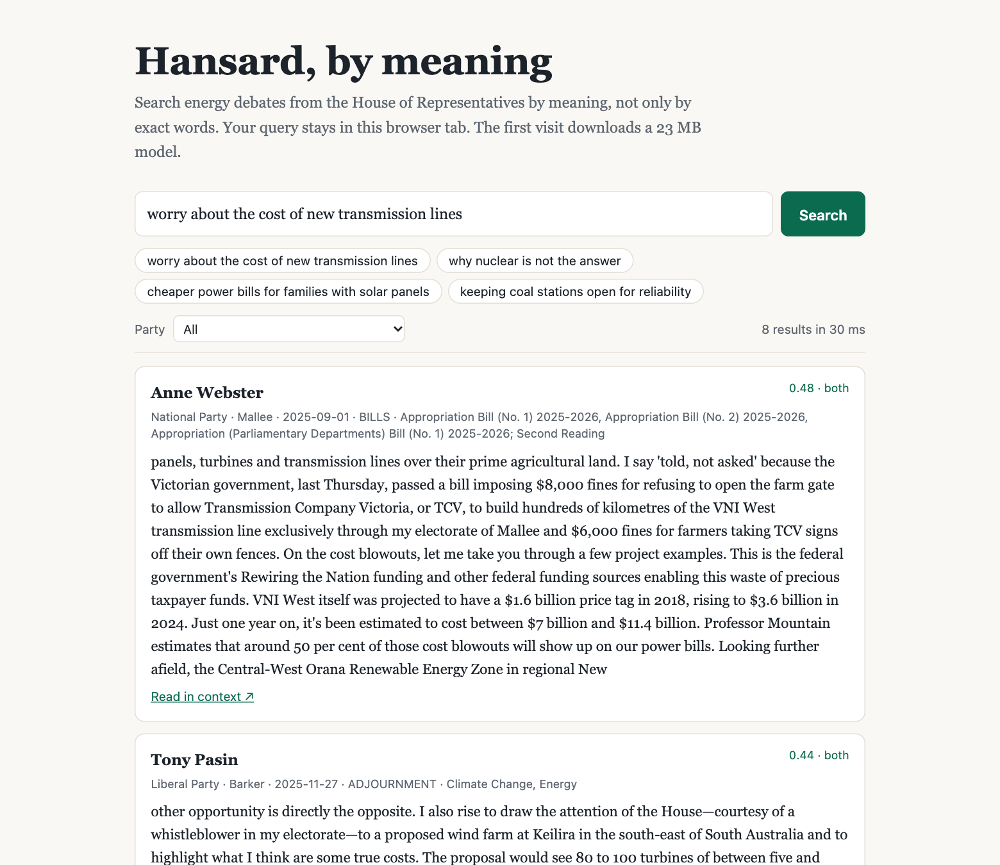

# hansard-semantic

> Search Parliament by meaning, entirely in the browser, with no server.

[](https://github.com/Guinerve/hansard-semantic/actions/workflows/ci.yml)

**v0.2:** MiniLM semantic search plus BM25 keyword ranking, a weak-match notice, a 50-query evaluation, and a browser benchmark.



## What it searches

3,430 energy-related passages from House of Representatives Hansard, covering 85 sitting days from **2025-07-01 to 2026-09-17**. Each result has a speaker, date, party, electorate, and source link. A party filter applies to both ranking lists.

The browser embeds your query with `Xenova/all-MiniLM-L6-v2` (q8). It searches the precomputed int8 vectors and a local BM25 index, then combines their top-100 lists with reciprocal-rank fusion. Result scores are embedding cosine similarities, not relevance probabilities. The labels `both`, `meaning`, and `keywords` show which lists found each passage.

Queries stay on your device. The first visit downloads the model and runtime files. There is no search API or application server.

## Stack

TypeScript, Vite, transformers.js, Vitest. A Node script fetches OpenAustralia's public scraped XML and builds the index. No API key is needed. The builder and browser use the same tokenizer, model, quantisation, and mean pooling.

Node **22.18 or later** is required. The dev and preview servers bind to `0.0.0.0:5193` with `--strictPort`. The production build is a static site. This repository remains private; no public deployment is claimed.

## Run it

The index is included. You do not need to rebuild it to run the app.

```bash
npm ci
npm run dev      # http://<your-host>:5193
npm test         # 16 tests; downloads the model on first run
npm run build    # type check and static build in dist/
```

## Reproduce the evaluation

```bash
npm run eval                  # MiniLM, BM25, and the shipped hybrid
npm run build
npm run bench -- --throttle    # Chrome; temporary preview server on port 5294
npm run label                 # human review at http://<your-host>:5293/label.html
```

`npm run eval` writes [`eval/RESULTS.md`](eval/RESULTS.md) and machine-readable results. `npm run bench` writes [`eval/BROWSER.md`](eval/BROWSER.md) and raw browser measurements. Set `CHROME_PATH` if Chrome is not in a standard location. Ports 5293 and 5294 must be free before their servers start.

The labelling page reads the committed judgments without a new pool. It records a judgment as `human` only when a person saves it. It accepts same-origin JSON writes and known query/passage IDs. Run it on a trusted network and stop it after review.

Optional, slower rebuilds:

```bash
npm run index                 # refetch/chunk/embed; raw XML cached in data/
npm run pool                  # add pools from all systems, including BGE and GTE
npm run eval -- --systems minilm,bge-small,gte-small,bm25,hybrid-minilm,hybrid-bge
```

Alternative models download their own weights and embed the corpus on the first run. After changing the corpus or pool, review the labels before comparing scores. The committed report does not claim a measured comparison with BGE or GTE.

## How I know it's right

18 tests in `src/search.test.ts`, `src/ranking.test.ts`, and `src/text.test.ts` check index integrity, embedding parity, semantic and keyword ranking, fusion, party predicates, empty input, zero-result requests, and XML entity decoding. Two of them guard the labelled set: every judged passage must exist in the index, and the shipped hybrid must keep nDCG@10 above 0.62 (measured 0.659), so a ranking regression fails CI. Re-embedding stored passages must give cosine > 0.98. The older 12-query keyword smoke check still passes, but it is not a relevance benchmark.

The harder evaluation has **50 queries and 1,487 pooled judgments**, including paraphrases, negation, known items, and out-of-scope questions. **All judgments are unreviewed `model-draft` labels.** Treat the results as exploratory, not independent validation.

| Ranker | nDCG@10 | P@5 | Negation: wrong-stance share |
|---|---:|---:|---:|
| MiniLM alone | 0.588 | 0.660 | 0.455 |
| BM25 alone | 0.558 | 0.651 | 0.231 |
| Shipped hybrid | 0.659 | 0.728 | 0.334 |

The hybrid's paired nDCG@10 difference is +0.071 (95% bootstrap interval 0.01–0.12). It still regresses on some queries. Known-item retrieval finds 3 of 6 targets in the top 10, versus 4 of 6 for MiniLM alone. The weak-match threshold, cosine < 0.3, was selected on this same set. It flags all 3 no-answer queries and 2 of 47 answerable queries.

## Browser check

The [50-query production benchmark](eval/BROWSER.md) records cold/warm model loads, network bytes, query times, heap use, and browser/Node differences. The browser and Node need not produce identical rankings: small q8 cosine differences reorder near-ties before fusion.

Additional Playwright checks on 2026-10-13 confirmed 8-result searches, party filtering, weak-match notices, clearing an empty search, and no horizontal overflow at 390 px. A delayed old query cannot overwrite a newer one. An injected worker crash stays visible even if a late download-progress message arrives.

Passage display decodes numeric XML entities before HTML escaping. The stored text and vectors are unchanged, so the published ranking results still describe the shipped index. The index builder also decodes hexadecimal entities for future rebuilds.

## Limits

- Negation and political stance are not reliable. Read the passage and its source before drawing a conclusion.
- The corpus is an energy-keyword slice, not all of Parliament. Speeches can contain unrelated topics. The filter has gaps.
- The int8 vectors are about 1.3 MB. Passage text is about 4.3 MB uncompressed. The first visit downloads about 23 MB of model weights from Hugging Face and the ONNX Runtime WASM (5.6 MB compressed) from jsDelivr; both are cached afterwards. `dist/` also contains a 27 MB copy of that WASM which the page never requests (measured in [eval/BROWSER.md](eval/BROWSER.md)), so the deployed site depends on those two third-party hosts.
- The relevance labels need human review. Recall is relative to pooled judgments, not every relevant passage in the corpus. The confidence intervals do not account for label error.

## Release checklist

- [x] Current screenshot and one-command run
- [x] Browser query embedding in a Web Worker and hybrid ranking
- [x] Reproducible tests, evaluation, benchmark, and stated limits
- [x] CI test/build workflow and badge
- [x] MIT code licence, repository description, and topics

## Follow-up

- Human-review the relevance labels with `npm run label`.
- Compare larger models after review. Broaden corpus coverage only with a new evaluation.
- Refresh the v0.1 demo GIF if needed; the screenshot above is the current UI.
- Pin the repository and add it to `guinerve.github.io` and `career-radar/data/cv/portfolio.json`.
